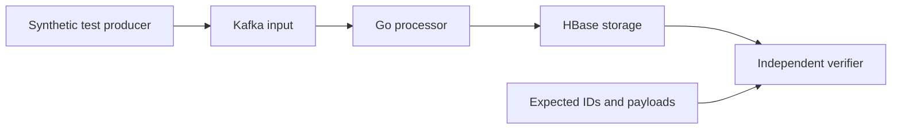

# Reliable Kafka to HBase Processing in Go

A role-focused backend engineering showcase exploring reliable persistence from Kafka into HBase, followed by evidence-based performance improvement. It uses synthetic data and is not affiliated with, or a representation of, LINE or LY Corporation's internal architecture.

## Current status

**Design and agent guidance only.** No application, Go module, broker, HBase deployment, automated checks, or performance results exist yet.

The agreed boundary is Kafka input to HBase persistence. Source transport and redundant ingestion are outside this project; those concepts are already explored in [stream-eos](https://github.com/manujkathuria/stream-eos).

## Start here

- [Architecture and correctness contract](docs/architecture.md): agreed scope, proposed design, failure cases, measurements, and open decisions.
- [Agent entry point](AGENTS.md): required guidance and task-based skill selection.
- [Engineering standards](.agents/standards/engineering-standards.md): reusable development expectations.

## Planned delivery

1. Build a basic timed maximum-speed Kafka producer with bounded buffering and acknowledgement reporting.
2. Agree on message identity, row model, replay semantics, Kafka partition ownership, and durability settings.
3. Build a sequential Kafka-to-HBase baseline with bounded resources.
4. Verify normal operation, partial failures, crash/restart, and uncertain outcomes against real dependencies.
5. Record a reproducible performance baseline.
6. Introduce batching and bounded concurrency only where measured bottlenecks justify them, preserving correctness checks.

Runtime prerequisites and commands will be documented when the dependency topology and implementation are agreed. No runnable commands or throughput targets are claimed at this stage.
