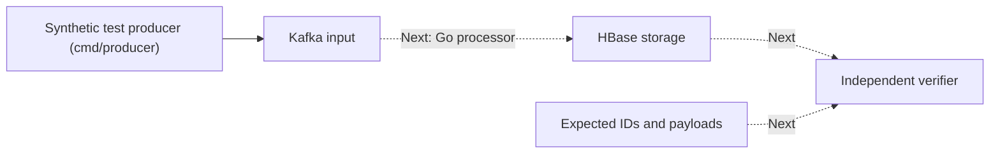

# Reliable Kafka to HBase Processing in Go

A role-focused backend engineering showcase exploring reliable persistence from Kafka into HBase, followed by evidence-based performance improvement. It uses synthetic data and is not affiliated with, or a representation of, LINE or LY Corporation's internal architecture.

## Current status

**Timed maximum-speed Kafka workload producer implemented ([Issue #3](https://github.com/manujkathuria/go-kafka-hbase/issues/3)).**
HBase processing and verifier are not implemented yet.



## Workload Producer (`cmd/producer`)

### Record Format & Key Mapping
- **Record encoding**: Binary layout with 27-byte header and 128-byte fixed payload (155 bytes total):
  - `0x01` (1 byte magic: `RecordMagic`)
  - `RunID` (16 bytes unique per run)
  - `SeqNum` (8 bytes uint64, big-endian, monotonic starting at 0)
  - `ValidLen` (2 bytes uint16, big-endian)
  - `Payload` (128 bytes fixed synthetic payload)
- **Deterministic Key mapping**: `key-%02d` where bucket = `SeqNum % 16`. This deterministically distributes records across Kafka partitions without implying conversation ordering.
- **Client & Reliability**: Built with `github.com/twmb/franz-go` (v1.22.2) requiring all-ISR acknowledgements (`RequiredAcks(AllISRAcks())`), idempotent production, and bounded reusable batch buffers.

### Prerequisites
- Go 1.27+
- A running Kafka broker (e.g. `localhost:9092`) with a pre-created topic. The producer validates broker reachability before publishing.

### Running the Producer
```bash
# Run for 10 seconds at maximum speed
go run ./cmd/producer -brokers localhost:9092 -topic messages.input -duration 10s

# Optional flags:
#   -batch-size (default 1000)
#   -drain-timeout (default 10s)
```

Example output:
```text
--- Producer Execution Summary ---
Run ID:          8b32d164...
Submitted:       50000
Acknowledged:    50000
Failed/Unacked:  0
Generation Time: 10.001s
Drain Time:      42ms
Total Time:      10.043s
Throughput (avg): 4978.59 records/sec (across 10.043s total window)
----------------------------------
```

### Verification
1. **Unit & Race Checks**:
   ```bash
   go test -v -race ./...
   go vet ./...
   ```
2. **Opt-in Real Broker Readback Test**:
   ```bash
   TEST_KAFKA_BROKERS="localhost:9092" TEST_KAFKA_TOPIC="messages.input" go test -v -run TestRealKafkaProducerReadback ./internal/producer
   ```
   This test runs the producer against a live broker, consumes all records for that specific run, and verifies that IDs, sequence monotonicity, key mappings, and complete payloads match independent expectations.

## Start here

- [Architecture and correctness contract](docs/architecture.md): agreed scope, proposed design, failure cases, measurements, and open decisions.
- [Agent entry point](AGENTS.md): required guidance and task-based skill selection.
- [Engineering standards](.agents/standards/engineering-standards.md): reusable development expectations.

## Planned delivery

1. **Done**: Build a basic timed maximum-speed Kafka producer with bounded buffering and acknowledgement reporting ([#3](https://github.com/manujkathuria/go-kafka-hbase/issues/3)).
2. Agree on message identity, row model, replay semantics, Kafka partition ownership, and durability settings.
3. Build a sequential Kafka-to-HBase baseline with bounded resources.
4. Verify normal operation, partial failures, crash/restart, and uncertain outcomes against real dependencies.
5. Record a reproducible performance baseline.
6. Introduce batching and bounded concurrency only where measured bottlenecks justify them, preserving correctness checks.
