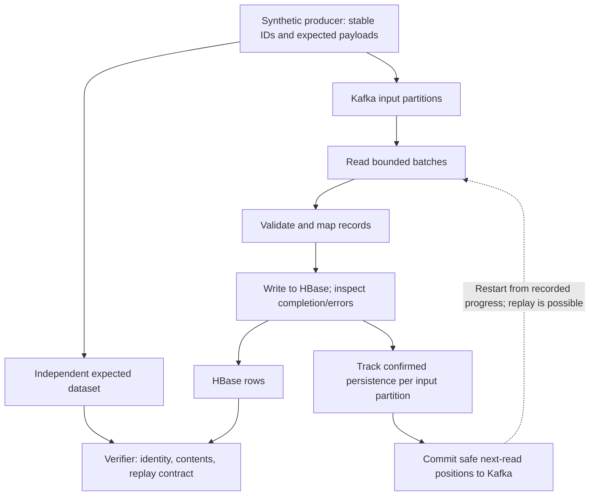

# Kafka to HBase architecture

## Purpose and status

Build a reproducible learning and showcase project for backend messaging and distributed storage work. Demonstrate correct persistence through failures, then improve measured performance. This design is inspired by a role description, not knowledge of the employer's internal implementation.

**Status: design only.** Requirements below are agreed at a conceptual level; message schema, row keys, runtime versions, deployment topology, and APIs are not finalized or implemented.

## Agreed scope

- Kafka is the service's durable input boundary. The source-to-Kafka delivery problem and redundant source ingestion are excluded.
- A Go processor reads input, performs the agreed transformation, and writes the intended result to HBase.
- Processing must not skip required persistence, silently truncate payloads, or corrupt stored results during retries or restarts.
- Memory and in-flight work are bounded. Overload must apply backpressure rather than grow storage without limit or silently drop input.
- Correctness verification precedes optimization. Measure performance at a defined completed-work boundary, not merely after enqueueing writes.
- An independent verifier checks expected message identities and payloads against actual stored data.

## Agreed first implementation slice

Build a basic synthetic producer directly into Kafka. It is workload tooling, not a separate source-transport showcase.

- Configure brokers, topic, and generation duration (for example 10 or 60 seconds).
- Generate at the maximum rate accepted with bounded buffering; no target-rate limiter, custom worker pool, UI, gRPC/WebSocket source, or redundant ingestion.
- Use a fixed payload size, a per-run identity, and sequence numbers so stored records can later be verified. Exact encoding and Kafka key mapping remain to be selected before implementation.
- At the duration deadline, stop generating and drain outstanding writes with a separate bounded timeout. Generation duration is not a strict bound on total runtime.
- Report acknowledged records, errors, generation duration, and drain time. Distinguish submissions from successful acknowledgements, and expose uncertain outcomes rather than silently treating them as success.
- Reuse storage only after Kafka client completion. Do not retain the entire generated dataset in memory.
- Do not claim throughput or a reliable-source guarantee before measuring and checking stored records. This producer does not establish Kafka-to-HBase performance.

## Proposed first data model

Use immutable synthetic chat messages with producer-assigned stable IDs. Retransmissions preserve the ID and intended content. Initially processing validates and maps the record into HBase fields; there are no external side effects or expensive business transformations.

This is a **proposal requiring agreement**, not an implemented contract. Define identifier uniqueness, maximum payload size, malformed-record handling, conflicting payloads under one ID, and whether one event writes one row before coding.

HBase row-key choice must balance replay identity, query access patterns, distribution, and hot-spot risk. Do not default to a globally increasing timestamp key. Specify cell versions/timestamps and how repeat writes behave: one visible row is not sufficient proof that retries leave no unintended versions. No unlimited exactly-once claim is made.

## Data flow

The initial implementation should be sequential within the agreed partition scope. Consumer-group ownership versus explicit partition assignment remains open. The design must address rebalances/fencing before claiming safe multi-instance operation.

## Completion and progress

Distinguish these milestones:

1. **Input accepted:** Kafka acknowledged the producer under specified broker/client settings. This is a prerequisite, not the processor's achievement.
2. **Persistence confirmed:** HBase acknowledged the required writes under agreed durability settings. A timeout may leave the outcome uncertain.
3. **Recovery progress recorded:** Kafka confirmed a next-read position that does not skip any unconfirmed input in that partition.

Wait for required HBase persistence before recording progress. If input offsets 100, 101, and 102 are being processed and only 100 and 102 have completed, progress cannot skip 101. In general, use the completed prefix of records actually consumed, not an assumption that all Kafka offset numbers are present or application records.

A batch API may partially succeed. Track actual per-record outcomes or apply the client's documented failure semantics; a batch return value alone must not be interpreted as all-success without evidence.

Kafka transactions cannot atomically commit an external HBase write. A crash after confirmed persistence but before confirmed Kafka progress causes replay. The final design needs replay-safe deterministic writes or an equivalent verified approach. Where conflicting content can share an ID, unconditional overwrites may be unsafe; resolve that contract first.

## Ordering and ownership

Define separately: Kafka append order, processing completion order, HBase visibility, and application conversation order. Kafka partition order alone does not prove ordered completion after adding workers.

The first baseline avoids concurrent writes within a partition until ordering requirements and progress tracking are established. Later concurrency must respect the same contract, bound in-flight work, and account for client connection/pool limits across instances.

Own record bytes until all asynchronous consumers finish. Do not return buffers to a pool or reuse batch storage while a driver may retain them. Cancellation requests stop; lifecycle coordination must also wait for owned workers and perform bounded cleanup.

## Failure tests

Use Go's testing package with real Kafka/HBase for integration semantics and child service processes for crash/restart tests. A narrowly scoped test checkpoint can make the crash window deterministic; do not depend on arbitrary sleeps. Test hooks are a proposal to implement only where needed.

| Scenario | Required observation |
| --- | --- |
| Stop before an HBase write | Input remains replayable; no progress skips it. |
| Some HBase writes fail | Successful siblings do not cause progress to skip failures. |
| HBase succeeds; process dies before progress commit | Restart replays safely and stored data satisfies the agreed identity/version contract. |
| HBase response is lost or times out | Resolve or retry the uncertain operation without corrupting results. |
| Kafka progress commit fails or is uncertain | Restart from recorded progress safely; no assumption that unconfirmed progress was saved. |
| Cancellation with in-flight writes | Bounded shutdown; no progress beyond confirmed required persistence. |
| Ownership changes while work is in flight | No stale owner advances progress or violates write/order semantics. Required before claiming multi-instance safety. |
| Malformed or conflicting input | Observable, agreed failure behaviour; no silent skip. |

The verifier compares expected identities and complete payloads for bounded tests. If large-run verification uses hashes or external sorting, document probabilistic checks and disk usage. Verify row-key mapping and relevant cell versions rather than trusting counters.

A single broker or HBase server is enough for initial service-crash and dependency-outage exploration, not replicated cluster failover. Multi-node failover tests are a later phase with their own topology and evidence.

## Performance methodology

Build a correct sequential baseline first. Separate component measurements from connected Kafka-to-HBase runs.

- Record Go/client/server versions, hardware, topology, payload distribution, partitions, durability/replication settings, row-key strategy, batch size, worker limits, and compression where applicable.
- Report offered input, HBase-confirmed unique logical messages, safe Kafka progress, retries, errors, backlog, elapsed time, CPU, memory, allocations, and GC evidence.
- Define latency boundaries before reporting p50/p95/p99. Distinguish service processing time from Kafka queue time; cross-process timestamps require appropriate clock treatment.
- Include warmup, steady measurement, and drain conventions. Measure achieved persisted output, not scheduled goroutines or attempted writes.
- Run repeated comparable samples where needed. Verify contents after the run and check replay behaviour after optimization.
- Do not weaken durability, skip validation, remove necessary state, or change semantics to improve throughput.

No target throughput or production-readiness claim is agreed. Prior stream-eos results are not results for this project.

## Decisions to resolve next

1. Message schema, stable identity, replay/conflicting-payload contract, and any ordering requirement.
2. HBase row keys, columns, versions, durability acknowledgement, and history-query requirements.
3. Kafka partition ownership, progress storage, and behaviour during rebalances or replacement.
4. Maintained Go HBase client, versions, partial-write/retry semantics, and bounded resource ownership.
5. Local Kafka/HBase setup and tooling. Native versus containerized deployment is open; stream-eos's native-Kafka preference is not automatically inherited.
6. Deterministic failure injection, independent verification, and meaningful acceptance criteria for the first implementation issue.

## Delivery milestones

- **Setup:** this documentation and reusable guidance only.
- **Producer:** implement the agreed minimal timed Kafka workload tool after resolving its record format and client setup.
- **Contract:** resolve the decisions needed for one minimal end-to-end persistence path.
- **Baseline:** sequential validated persistence with bounded resources.
- **Recovery:** real-dependency tests for replay, partial failures, uncertain outcomes, and process restart.
- **Measurement:** reproducible connected baseline and selected component benchmarks.
- **Optimization:** evidence-led batching/concurrency changes, preserving failure tests.
- **Extensions:** optional multi-instance/cluster failover and a small operations UI only after the baseline is understood.
